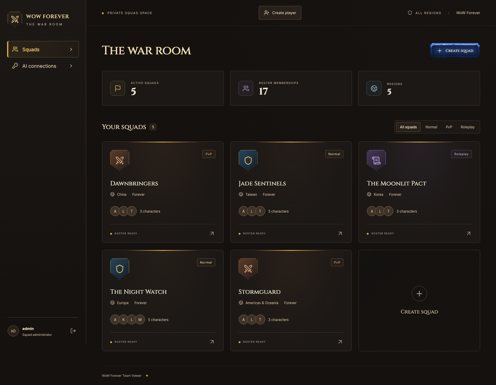
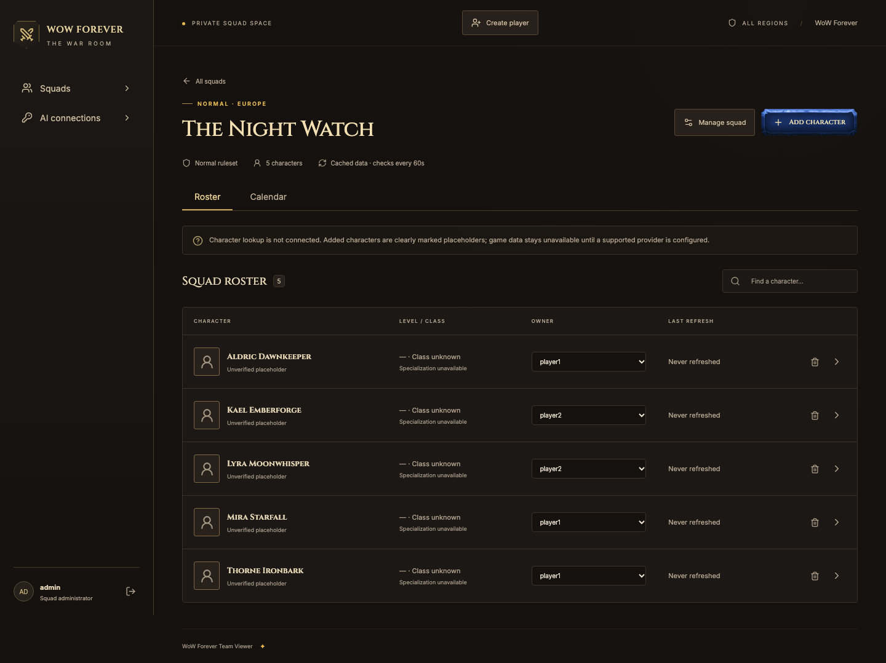
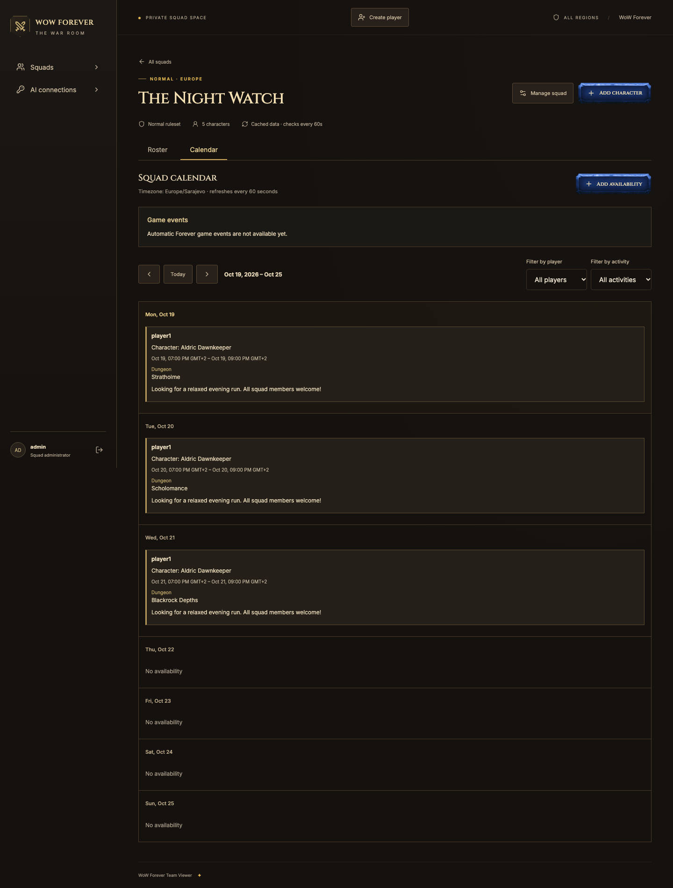
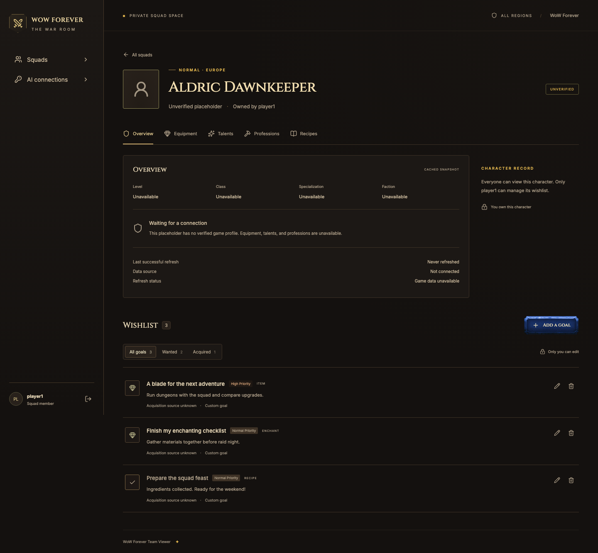
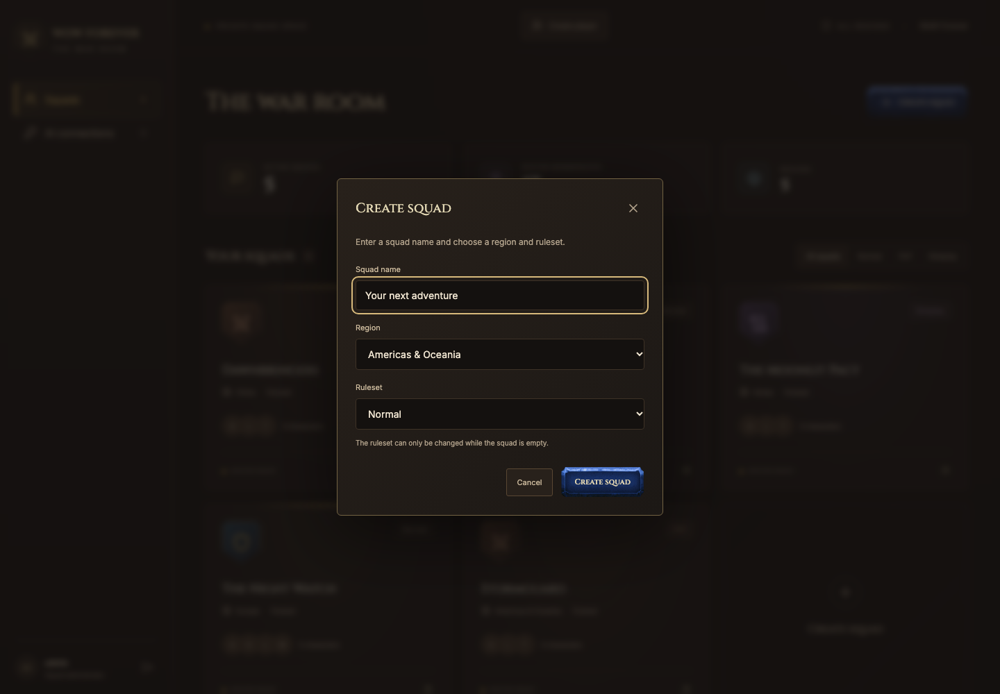
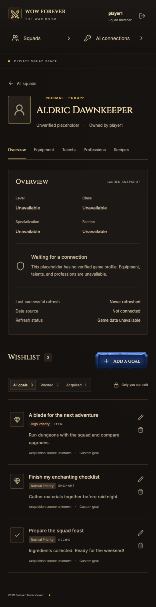
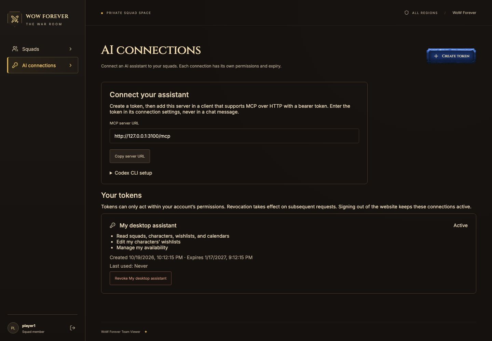
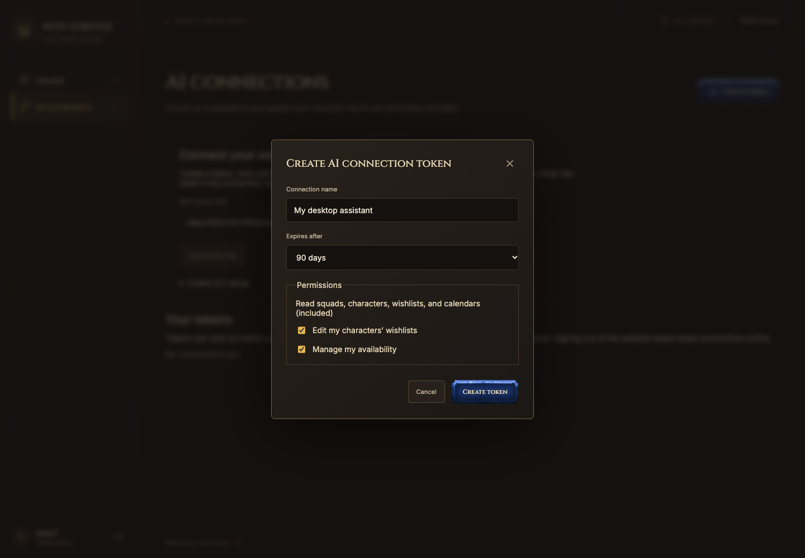

# WoW Forever — The War Room

A private squad roster and upgrade wishlist for World of Warcraft: Forever across Europe, Americas & Oceania, Korea, Taiwan, and China, built with pnpm, TanStack Start, React, WarcraftCN, and Cloudflare D1 (SQLite).

## UI preview

Screenshots use fictional demo squads, unverified character placeholders, and custom wishlist goals.

















Full-resolution PNGs are in [docs/media](docs/media) for README use and social posts. Regenerate them with `pnpm exec playwright install chromium` followed by `pnpm media:capture`. The capture command starts a local server on port 3100 and resets only the disposable `.wrangler/e2e` database; do not run it alongside browser tests. Login keys are never included in screenshots.

## Squad regions

Admins choose a **Region** and **Ruleset** when creating a squad. Supported regions are Europe (`eu`), Americas & Oceania (`us`), Korea (`kr`), Taiwan (`tw`), and China (`cn`). Europe is the default.

Squad cards and character pages display their region. Characters can join multiple squads only when both region and ruleset match. Characters with the same name in different regions remain separate records. A squad's region is fixed at creation; its ruleset can change while the squad is empty.

Existing squads and characters remain in Europe. Before deploying this change, run `pnpm db:migrate:remote` to apply `0006_regions.sql` (use `pnpm db:migrate` locally). The migration preserves rosters, ownership, wishlists, refresh data, and calendar entries.

## Current data availability

Squads, shared name-only character placeholders, ownership, login, and custom wishlists work without an external API. **Live character lookup, equipment, images, catalog search, and automatic acquisition discovery are unavailable until a documented Forever provider is verified and configured.** The app does not substitute retail/Classic data or invented character records. See [data-source audit](docs/data-sources.md).

The cache and scheduled refresh infrastructure are implemented for a verified provider. Unsupported providers do not repeatedly fetch, and placeholders are never refreshed as if they were real profiles.

## Local setup

Use Node.js 22.12 or newer and pnpm 10.33.0.

```sh
pnpm install --frozen-lockfile
pnpm db:migrate
pnpm keys:seed-admin
pnpm dev
```

Open http://127.0.0.1:3000. Save the generated keys in a password manager. The seed creates only `admin` with the administrator role. Its key is shown once and only its hash is stored. Rerunning the seed preserves existing accounts and keys; it does not delete players. Sign in as admin and use **Create player** to add player accounts. Save each generated login key before closing the dialog and share it with that player. Public registration is disabled.

```sh
# Generate a replacement key and revoke this user's existing sessions
pnpm keys:rotate admin
```

To insert another account manually, run `node scripts/access-keys.mjs generate username` (optionally `--admin`). It prints an INSERT statement containing only the hash and shows the generated login key separately. Run that SQL in your chosen database. The `create` command executes the same insertion for you; neither operation exposes a registration endpoint.

These credentials are high-entropy random keys, not human-chosen passwords. Do not replace them with memorable passwords: the fast SHA-256 verifier is designed specifically for generated 192-bit secrets.

Local data lives in `.wrangler/state/` and is ignored by Git. Production uses a separate D1 database. No Battle.net credentials are currently required because the unverified integration is disabled.

## Personal MCP connections

The app serves a stateless Streamable HTTP MCP endpoint at `/mcp`. Sign in and open **AI connections** to create a named personal token. Copy the token from its one-time dialog, then configure your MCP client with the server URL and bearer token. Token secrets are stored only as hashes and cannot be recovered from the token list.

Read access is selected by default. Optional permissions allow editing your characters’ wishlists and managing your availability. Tokens do not grant administrator powers or bypass ownership. Each token expires after 1–365 days and can be revoked separately. Disabling an account or rotating its login key revokes its MCP tokens; website logout leaves connections active. Last-use timestamps are updated at most every five minutes.

Apply migrations `0007_mcp_tokens.sql` and `0008_mcp_writes.sql` before running the updated app (`pnpm db:migrate` locally, `pnpm db:migrate:remote` for an existing deployment). The latter adds wishlist versions, mutation audit records, and create-request deduplication. Back up production data before your normal migration/deployment procedure.

### Codex CLI configuration

Add the following to your Codex `config.toml`, replacing the example URL with your deployed app URL:

```toml
[mcp_servers.war_room]
url = "https://your-app.example/mcp"
bearer_token_env_var = "WAR_ROOM_MCP_TOKEN"
```

Set `WAR_ROOM_MCP_TOKEN` in the environment that launches Codex, then restart the client. Keep the token out of chats, repository files, and URLs. Local development can use `http://127.0.0.1:3000/mcp`; deployed connections should use HTTPS. This is a configured bearer-token connection, not an OAuth sign-in flow. See the [official Codex MCP configuration documentation](https://developers.openai.com/codex/mcp).

### Available tools

| Tools | Required token scope |
| --- | --- |
| `get_my_context`, `find_characters`, `list_squads`, `get_squad`, `get_character`, `list_wishlist`, `get_squad_calendar`, `get_capabilities` | `read` |
| `add_wishlist_entry`, `update_wishlist_entry`, `delete_wishlist_entry` | `wishlist:write` |
| `create_availability`, `update_availability`, `delete_availability` | `availability:write` |

Character discovery returns candidates with stable IDs, region, ruleset, ownership, and verification status. Resolve ambiguous names before writing; mutations take IDs rather than character names. Availability timestamps must include `Z` or an explicit UTC offset. Reads are limited to 42 days; a slot lasts at most 48 hours.

Updates and deletes require the latest record `version`; partial updates preserve omitted fields. Creates require an `idempotencyKey`: keep the same key and payload when retrying a request, and use a fresh key for a new operation. Reusing a key with a different payload fails. Successful MCP mutations record the user, token ID, operation, target, and timestamp without logging token secrets. Deduplication records retain the create payload and result in D1; audit/deduplication retention is not automatically pruned in this release.

No administrative mutations, account creation, or live game-provider integration are exposed. Game capabilities report the actual configured provider state; manual wishlist and availability operations work without Blizzard connectivity.

`pnpm test` covers token lifecycle, authorization, conflicts, retries, and SDK protocol requests. `pnpm test:e2e` additionally creates a token in the browser, connects the official MCP SDK client to the local Worker, updates an owned wishlist, verifies the website result, and revokes access. It uses only the disposable test database. Production hosting, client-specific setup, and Worker usage still require deployment validation.

## Blizzard OAuth preparation

Optional Blizzard credentials belong in the ignored `.env.local` file, using `BLIZZARD_API_CLIENT_ID` and `BLIZZARD_API_CLIENT_SECRET` (see `.env.example`). Run `pnpm blizzard:check` to verify the client-credentials exchange. It prints only the result and token lifetime; tokens are never saved. This does not enable Forever data fetching or Battle.net login for users.

The Cloudflare Vite plugin loads `.env.local` into server bindings. Do not add a `.dev.vars` file alongside it, because that takes precedence over `.env` files. Never prefix these credentials with `VITE_`. For deployment, set each credential using `pnpm exec wrangler secret put BLIZZARD_API_CLIENT_ID` and `pnpm exec wrangler secret put BLIZZARD_API_CLIENT_SECRET`; local secrets are not deployed automatically.

## Permissions and behavior

- All accounts view all squads, characters, and wishlists.
- Admin creates player accounts and creates and edits squads, adds/removes characters, and assigns a single owner.
- Only the assigned owner can edit a character's wishlist. Admin must also be the owner to edit it.
- A character may belong to several squads with the same region and ruleset. Ownership and wishlist are shared.
- Removing a membership or deleting a squad preserves the character and wishlist. Unreferenced characters stop refreshing.
- Rulesets can change only for empty squads. The app stores at most 50 characters, including unreferenced placeholders.
- Wishlist entries support priority, notes, an HTTPS source link, and wanted/acquired status. Custom goals have no automatically verified acquisition source.

## Validation

```sh
pnpm build
pnpm typecheck
pnpm test
pnpm exec playwright install chromium
pnpm test:e2e
```

Browser tests use port 3100 and a separate disposable database under `.wrangler/e2e`; they never rotate your normal local keys. They cover region selection during squad creation, admin roster management, owner-only wishlists, read-only members, invalid login, and mobile layout.

The build generates the TanStack route tree; run it before type checking a fresh checkout if the generated route tree is missing. Runtime integration tests launch a local Cloudflare runtime and need permission to bind loopback sockets.

## Cloudflare free-tier deployment

Deployment is intentionally manual. This repository has not enabled billing or deployed resources.

1. Sign in with `pnpm exec wrangler login`.
2. Create the free D1 database with `pnpm exec wrangler d1 create wow-forever-squads`.
3. Replace the all-zero `database_id` in `wrangler.jsonc` with the returned ID. Keep the binding named `DB`.
4. Run `pnpm db:migrate:remote` and `pnpm keys:seed-admin --remote`. Store the production keys securely.
5. Run `pnpm deploy`.
6. Verify login, logout, permissions, and the minute cron in the deployed environment. Inspect CPU, subrequests, and D1 usage before considering free-tier compatibility verified.

One scheduled invocation processes at most one due, referenced, verified character, with a one-hour successful refresh interval. Browser polling reads cached D1 data every minute while visible. Upstream failures use bounded backoff and preserve existing data. This targets 50 characters without paid queues or storage services.

The local tests cannot prove Cloudflare production CPU limits. If the free tier cannot support the measured workload, treat that as a deployment blocker; do not silently enable paid services.

## UI attribution

The [WarcraftCN](https://www.warcraftcn.com/) button includes the original library's locally bundled textures and an adapted React implementation. See the [upstream source](https://github.com/TheOrcDev/warcraftcn-ui) and the bundled [MIT license](src/components/ui/warcraftcn/LICENSE.md). Other application layouts are custom. This fan application is not affiliated with Blizzard Entertainment.

The administrator username is reserved as `admin`; database triggers and account scripts reject other administrator names. Run migrations on existing databases before using the new account UI. `pnpm keys:seed` remains the optional three-account development seed (`admin`, `player1`, `player2`); use `pnpm keys:seed-admin` for a new installation.

## Squad calendar

Open a squad and select **Calendar** to coordinate availability. The calendar shows the entire Monday–Sunday week as vertically stacked days on every screen size. Times are entered and displayed in the viewer's local timezone, which is labeled in the UI; storage uses UTC. Overnight sessions appear on each day they overlap.

Players can create availability in squads where they own a character; administrators can create their own availability in any squad. All signed-in accounts can view calendars, consistent with roster visibility. Only an entry's author can edit or delete it, even after losing their last character in the squad. Administrators cannot edit someone else's availability. Deleting a squad deletes its calendar entries; removing a character does not.

A slot can optionally select one of the author’s characters in that squad. All owned characters are offered, including alts; the server validates ownership and squad membership on every save. If a selected character is reassigned or removed, choose another character or clear the selection when editing. Deleting a character clears its calendar selection without deleting the slot.

A slot can include several named dungeons, raids, or battlegrounds and an optional note, or simply indicate availability. Sessions are limited to 48 hours, 10 activities, and a 2,000-character note. Concurrent edits are detected and require reloading the latest entry. Calendars refresh every minute while visible and on focus; successful changes refresh immediately.

Automatic Forever game events are a separate, capability-gated integration. No verified Forever calendar HTTP source is configured, so the UI reports that automatic events are unavailable. It does not substitute retail or Classic schedules, invent battleground rotations, or require Blizzard connectivity for player availability.
